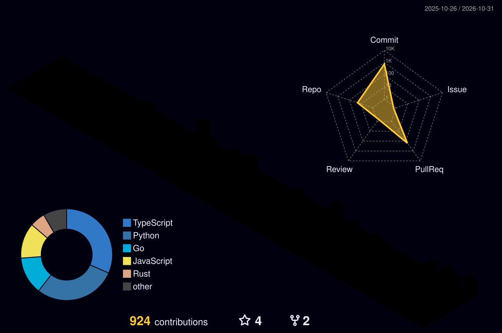

<!-- HEADER -->


<p align="center">
  
  
</p>

<p align="center">
  <a href="https://ryanqiportfolio.vercel.app/"></a>
  <a href="https://www.linkedin.com/in/ryan-qi/"></a>
  <a href="mailto:r28qi@uwaterloo.ca"></a>
  <a href="https://github.com/Lushenwar"></a>
</p>

<p align="center">
  
  
  
</p>

---

## Featured Projects

<details open>
<summary><b>⛴️ Ferryman</b> · Zero-Downtime Postgres Migrator</summary>

<br>

A Go CLI that orchestrates zero-downtime Postgres cutovers. It backfills in parallel ctid page ranges, streams live changes through logical replication, and only cuts over once replication lag clears its prechecks.

| | |
| :--- | :--- |
| **Stack** | Go · PostgreSQL · Logical Replication · Docker · GitHub Actions |
| **Scale** | Parallel backfill across ctid page ranges with live change streaming |
| **Safety** | Replication-lag gating, enforced DDL ordering, automated rollback to source state |
| **Reliability** | CI runs every migration against seeded Postgres instances |
| **Repository** | [Lushenwar/Ferryman](https://github.com/Lushenwar/Ferryman) |

</details>

<details open>
<summary><b>🛡️ Sentinel</b> · AI-Boosted Incident Response</summary>

<br>

An incident-response engine that cross-references git history against error logs to find the commit that broke production, then writes the diagnosis and postmortem for you.

| | |
| :--- | :--- |
| **Stack** | FastAPI · Next.js · TypeScript · PostgreSQL · RAG |
| **Performance** | Faulty commit surfaced as top candidate in ~13s; root-cause diagnosis in ~14s |
| **Coverage** | DB failures, memory leaks, null pointers, and other bug classes |
| **Automation** | RAG over runbooks; postmortems auto-posted to Slack when error rates cross thresholds |
| **Repository** | [Lushenwar/Sentinel](https://github.com/Lushenwar/Sentinel) |

</details>

---

## About

I'm a Math (Data Science) student at the **University of Waterloo** focused on **infrastructure and site reliability engineering**. I like the systems that keep everything else running: database migrations that can't lose data, incident tooling that finds the bad commit before a human does, and real-time code with bounded, predictable behavior.

My background spans embedded C++ flight software, a production clinical portal serving 400+ staff, and multi-agent AI pipelines. The common thread is correctness under load and knowing exactly what happens when something fails.

**Open to:** infrastructure, SRE, and backend engineering internships.

---

## Tech Stack

**Languages**

<p align="center">
  
</p>

**Frameworks**

<p align="center">
  
  <br>
  
  
  
</p>

**Data, Cloud &amp; Infrastructure**

<p align="center">
  
  <br>
  
</p>

---

## Engineering Focus

<div align="center">

| Domain | Proficiency | Details |
| :--- | :---: | :--- |
| **Infrastructure / SRE** | ●●●●○ | Zero-downtime migrations, logical replication, incident response, CI gating |
| **Backend Systems** | ●●●●○ | FastAPI, Express, PostgreSQL schemas, role-based access control |
| **Systems Programming** | ●●●●○ | Real-time C++, no dynamic allocation in control loops, build optimization |
| **Applied AI** | ●●●○○ | RAG pipelines, multi-agent LangGraph orchestration, K-Means clustering |

</div>

---

## Experience

**Software Engineer Intern** · Mon Sheong Foundation
`May 2026 – Aug 2026`

Digitized fully paper-based care workflows into an end-to-end clinical portal.
- Built the Next.js / Node.js portal, cutting patient record retrieval time by 40% across daily nursing operations.
- Engineered role-based access control for Express APIs and PostgreSQL schemas, scoping every query by role for 400+ staff across 30 roles.
- Built real-time React dashboards with automated threshold-triggered alerts for clinical metrics.

<sub>`Next.js` `Node.js` `Express` `PostgreSQL` `RBAC` `React`</sub>

<br>

**Embedded Flight Software Developer** · Waterloo Aerial Robotics Group (WARG)
`Sep 2025 – Jan 2026`

- Removed dynamic memory allocation from the real-time control loop of C++ flight modules for deterministic, bounded execution.
- Restructured header dependency trees and build scripts, reducing firmware compile time by 25%.
- Optimized IMU sensor fusion filters to eliminate jitter, reaching 95% signal consistency.

<sub>`C++` `Embedded` `Real-Time Systems` `Build Systems` `Sensor Fusion`</sub>

<br>

**Research Lead** · UpNxxt (via Riipen Labs)
`May 2026 – Jun 2026`

- Led UX research for the AI Sandbox, analyzing competitor engagement loops to cut onboarding friction.
- Designed child-first mechanics adopted into the roadmap, contributing to a 15% DAU lift over six months.

<sub>`UX Research` `Product Strategy` `Retention`</sub>

---

## Achievements

<div align="center">

| Recognition | Details |
| :--- | :--- |
| 🥇 **1st Place, GenAI Genesis 2026** | [Eco-Pulse](https://github.com/Lushenwar/Eco-Pulse): urban heat planner over 178K land parcels |
| 🏆 **Winner, DeerHacks V** | [LOCATR](https://github.com/Lushenwar/LOCATR): 6-agent LangGraph venue planner, <1s cached |
| 🏆 **Best Use of Snowflake** | CxC 2026 |
| 🎖️ **Finalist, 4 Tracks** | YHacks Spring 2026 |
| 🥉 **3rd Place, Beginner Stream** | Hack404 |

</div>

---

## GitHub Activity

<p align="center">
  
  
</p>

<p align="center">
  
</p>

<p align="center">
  
</p>

<p align="center">
  
</p>

---

## Current Focus

```yaml
learning:    [ distributed systems, database internals, observability ]
building:    [ zero-downtime data tooling, incident response automation ]
exploring:   [ Kubernetes, SLOs and error budgets, chaos engineering ]
open_to:     [ infrastructure / SRE / backend internships ]
```

---

## Connect

<p align="center">
  <a href="mailto:r28qi@uwaterloo.ca"></a>
  <a href="https://www.linkedin.com/in/ryan-qi/"></a>
  <a href="https://github.com/Lushenwar"></a>
  <a href="https://ryanqiportfolio.vercel.app/"></a>
</p>

<p align="center"><i>Build systems that fail safely.</i></p>


